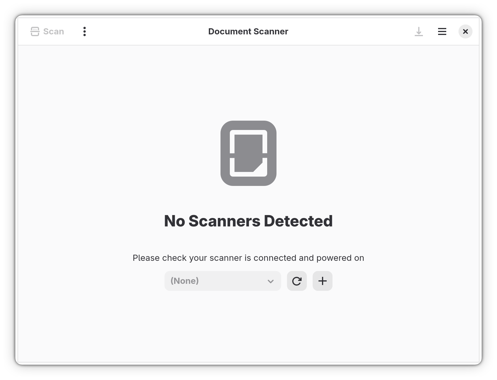
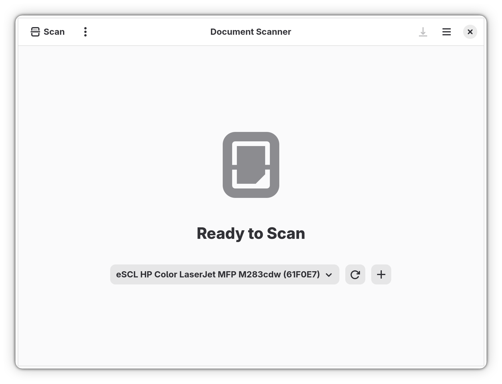
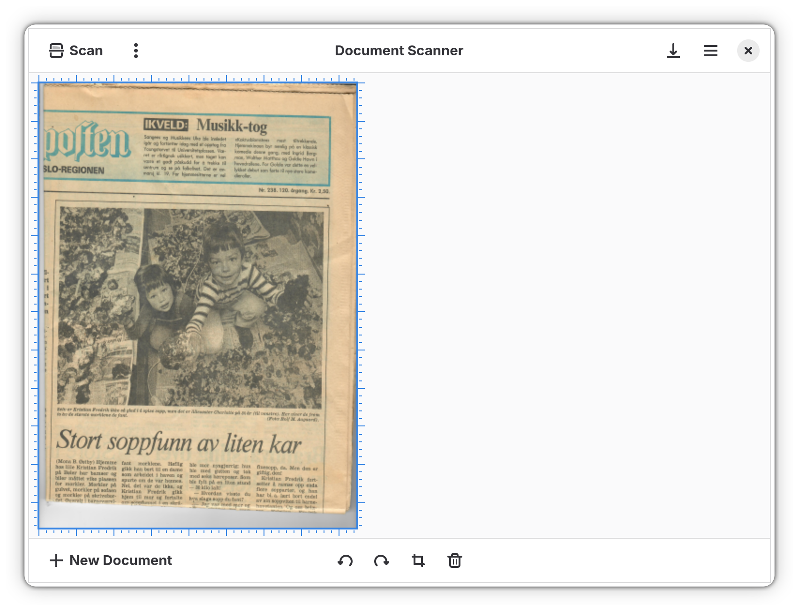

# Simple Scan on the scanner portal (prototype)

`simple-scan/` is GNOME Simple Scan (upstream bfa17c8, 50.0) with the commits of the
`scanner-portal` branch on top, imported with their history: they put libsane behind a
`ScanBackend` interface and add `PortalBackend`, which talks to the draft
`org.freedesktop.portal.Scanner` interface. The rest of the repository holds the flatpak
manifests, the CI workflow and the test results. The portal itself is in
https://github.com/cschalle/flatpak-scanner-portal.

## Screenshots

*The port in the Flatpak, without `--device=all` and without `--share=network`, talking to the
prototype service. An application that goes through the portal sees only the scanners the user
has allowed it, so it starts with an empty list instead of everything libsane can find. The
**+** beside the scanner chooser is what the port adds: it calls `SelectScanners`, and the
portal, not the application, decides what comes back.*

*After **+**. The portal granted one scanner and the port can use it; everything else on the
machine stays invisible to it. The scan itself runs in the service on the host, so the sandbox
still needs no network of its own and no access to any device node. Note that the other scanner
here, a Plustek OpticFilm 8200i, is not offered: the port asks for `flatbed` or `feeder`, and a
film scanner has neither.*

*A 300 dpi colour scan, 2550 x 3508, made through the portal. The application never opened the
scanner itself: it asked the portal for a session, set its options and read the frame over
D-Bus, inside a sandbox with no device access and no network.*

## Where the portal code is

The portal is in https://github.com/cschalle/flatpak-scanner-portal:

- `docs/PROPOSAL.md`: the proposal, with what was tested and what is open.
- `docs/org.freedesktop.portal.Scanner.xml` and `docs/org.freedesktop.impl.portal.Scanner.xml`:
  the draft D-Bus interfaces.
- `docs/HARDWARE-TEST.md`: the hardware test.
- `tests/` and `tools/portal-hw-check.sh`: the scenario checks that run against any frontend.

The prototype service and the portal client are Rust crates that stay in the negative-vibes
repository, https://github.com/cschalle/negative-vibes: `crates/nv-portal-proto` (service) and
`crates/nv-sane-portal` (client).

The C frontend and the GNOME and GTK dialogs are in
https://github.com/cschalle/flatpak-scanner-portal as patch series for xdg-desktop-portal,
xdg-desktop-portal-gnome and xdg-desktop-portal-gtk, together with the RPM build script. The
branches they come from are in clones kept in `../portal-research`, along with the flatpak
repository; those branches are not pushed.

The port follows the draft as of the second change round (automatic values as the vardict
`{'auto': true}`, a `frame` number on `FrameEvent`, `type` in the scanner info) and the two-phase
listing (`UpdateScanners`). Simple Scan asks for scanners with the `flatbed` or `feeder`
capability, and it skips scanners whose type is `virtual device` or `film scanner`. So neither
the SANE `test` backend nor a film scanner is visible to it, and a machine that has only one of
those has nothing the port will take.

## Download

CI builds the flatpaks on every push to `main` and attaches them to the rolling
[latest release](https://github.com/cschalle/gnome-simple-scan-portal/releases/tag/latest):

- `simple-scan-portal.flatpak`: the app that uses the scanner portal on the desktop.
- `simple-scan-portaltest.flatpak`: the test build, which needs the prototype service on the host
  (see below).

Install one with

    flatpak install --user simple-scan-portal.flatpak

Pull requests upload their bundles as workflow artifacts instead.

## Build and run

Build from this directory (needs GNOME Platform/Sdk 49):

    flatpak-builder --force-clean --disable-rofiles-fuse build-fp org.gnome.SimpleScan.PortalTest.json

The manifest has no `--device=all` and no `--share=network`. With a desktop that has the portal
installed, `org.gnome.SimpleScan.Portal.json` builds the app that uses it; install it from a
local repository with `--repo` and `--default-branch=portal`.

Without the portal on the desktop, start the prototype service on the host (test backend:
`SANE_CONFIG_DIR` with only `test` in `dll.conf`, `NV_SANE_ALLOW_VIRTUAL=1`,
`nv-portal-proto --select test:`; for a real scanner a `dll.conf` that lists only that scanner's
backend), then

    flatpak-builder --run build-fp org.gnome.SimpleScan.PortalTest.json simple-scan --debug

`SIMPLE_SCAN_BACKEND=portal` and `SIMPLE_SCAN_PORTAL_BUS_NAME` are set by the manifest. Use
`--env=GSETTINGS_BACKEND=memory` and XDG_* overrides to leave `~/.var/app` alone. A scan writes
autosaved pages to `~/.var/app/org.gnome.SimpleScan/cache/simple-scan/autosaves/` whatever the
overrides are.

A network scanner needs `--network`. Without it the service asks libsane for local devices
only, so an eSCL or WSD scanner is discovered by the backend and then dropped before any
application sees it, and `SelectScanners` comes back with nothing granted.

Never open all SANE devices with the system configuration on a Plustek OpticFilm 8200i: the
stock `genesys` entry for it resets the scanner. Use a private `SANE_CONFIG_DIR`.

## Git policy

The commit rules are the ones adopted from git-stage-batch for the negative-vibes repository and
used for every clone here.

- **No `Co-Authored-By` trailer and no other AI attribution line**, on commits or in pull
  request descriptions.
- **Subject:** `component: Summary`, at most 72 characters, in the imperative, with no trailing
  period. The component is the file, area or class the change is in.
- **Body:** lines of at most 75 characters. Declarative, present tense, starting with "This
  commit …". It explains why, not only what, and states no history that did not happen.
- **One logical change per commit.** Every commit builds on its own. Split a mixed working tree
  into commits by hunk (`git stage-batch`, or `git add -p`) and check each result compiles.
- **Tests:** the message says what was tested and what was not, and claims no result before it
  has been run. Measurements for anything that touches scanning or the pipeline.
- Write the message to a file and commit with `git commit -F file`. Check the widths first, and
  do not chain the commit after a check that only prints.
- Nothing is pushed until it is asked for.
